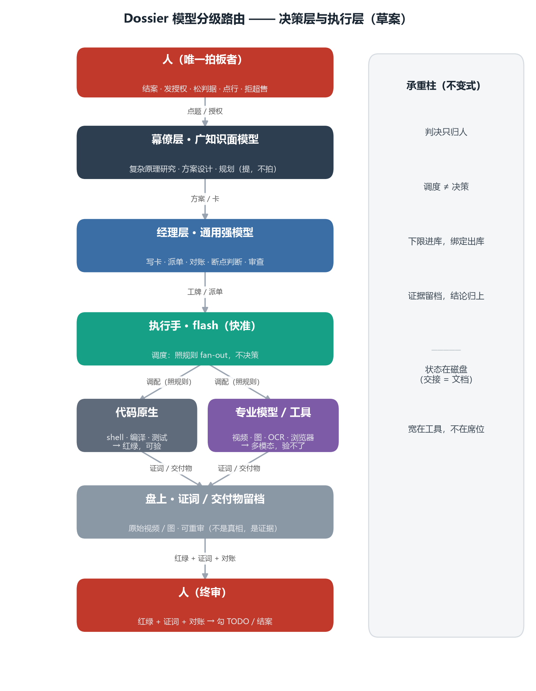

# 模型分级路由（草案）

**权威：参考。草案。** 不带标记，一条不可引。议事材料，为人建立整体图景；落地先有人裂成 todo 行。

## 一张图

## 分层（权威自上而下）

| 层 | 模型 | 干什么 | 判 / 产 |
|---|---|---|---|
| 人 | — | 结案 · 发授权 · 松判据 · 点行 · 拒超售 | 判（唯一拍板者） |
| 幕僚层 | 广知识面模型 | 复杂原理研究 · 方案设计 · 规划 | 提，不拍 |
| 经理层 | 通用强模型 | 写卡 · 派单 · 对账 · 断点判断 · 审查 | 判（恒重） |
| 执行手 | flash（快准） | 调度：照规则 fan-out，不决策 | 调度 |
| 专业模型 / 工具 | 专项模型 | 代码原生（可验）+ 多模态（视频·图·OCR，验不了） | 产 |
| 盘上 | — | 证词 / 交付物留档，可重审 | 证据 |

## 四根承重柱（不变式）

1. **判决只归人**——模型只提案 / 调度 / 生产，不拍板。
2. **调度 ≠ 决策**——flash 照规则 fan-out，不发明规则；发明 = 松判据 = 人。
3. **下限进库，绑定出库**——能力下限（重/轻/多模态）+ 来源约束进 `roles.md`，可 grep；具体型号住应用侧。触下限 = 松判据 = 人。
4. **证据留档，结论归上**——机器验不了的多模态，原始视频/图落盘，终审归人。

## 两条贯穿纪律

- **状态在磁盘**：层间交接 = 卡 / 工牌 / 证词 / 日志，不是上下文快照。换模型 = 换绑，不 = 重讲故事。
- **交接面最小**：席位少、工具多——宽在工具，不在席位。

## DSH 的位置

- DSH = 执行底座：跑席位（会话级）+ 插件面（「专业模型 / 工具」这层的家）。
- Dossier = 政策层：盘上的卡 / 下限表 / 证词，可 grep、可审计、进 git。
- 边界：DSH 执行，不拥有真相；Dossier 出策略，DSH 消费绑定。

## 未决

- 来源轴（国产 / 自托管）要不要作为「经理档」的下限进库。
- flash 分档的可盖谓词没有命令形态（见 `loop.md` 追记第十节）。
- 身份不透明：会话读不到自己跑在哪个模型，靠行为探针（资格测 / 影子回放，见 `model-routing.md`）。
