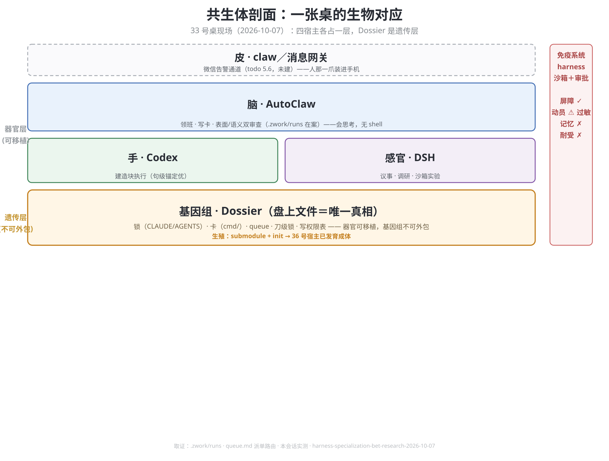
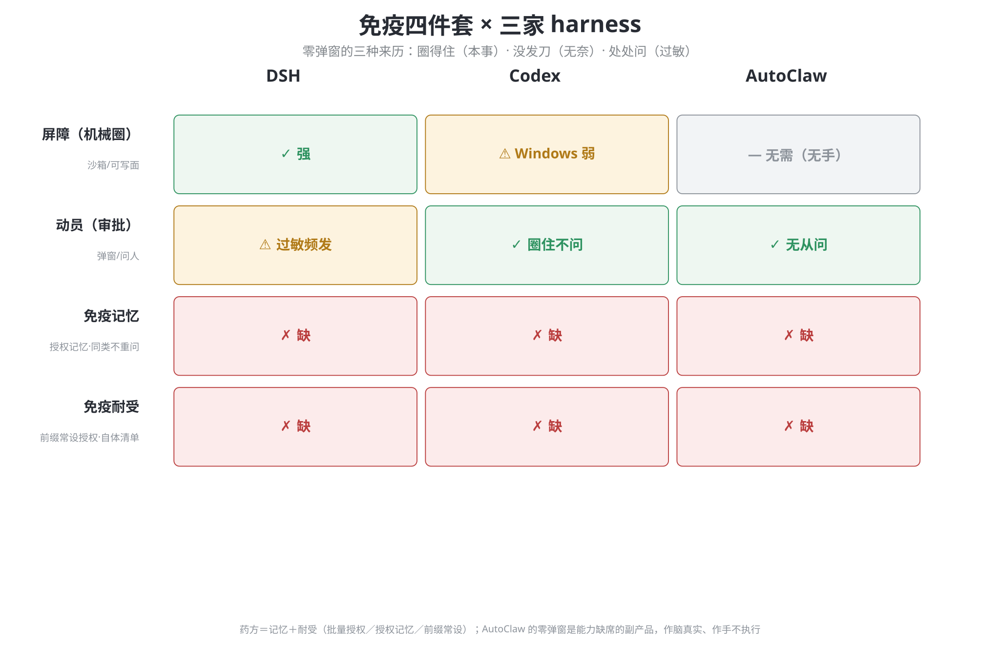
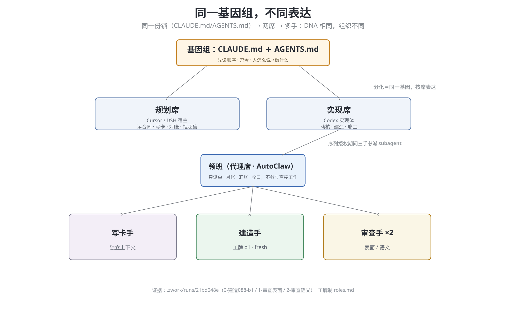

# organism-map：一张桌的生物对应

**性质**：思路层材料，不当判据引。议事衍生的比喻地图，用处是给「多 harness 共生 + Dossier」这张架构图一个可讲的说法；讲得通不等于证明力。
**来历**：人 2026-10-07 原话点名：「写个短一点的design文档吧，这个对应关系还是挺好玩的，可以配一些用matplotlib画的关系图」；比喻原话：「有点像……人的免疫系统，不能过敏，也不能免疫失效」。
**取证底座**：33 号桌现场（`.zwork/runs/`、queue.md 派单路由、本会话实测）＋ [harness 选型报告](../reports/harness-specialization-bet-research-2026-10-07-dsh-glm5.3.md)。

## 1. 对应表

| 生物学 | 这张桌 | 证据 |
|---|---|---|
| 器官（可移植） | 脑＝AutoClaw（领班/写卡/双审查）；手＝Codex（建造块）；感官＝DSH（议事/调研） | `.zwork/runs` 连夜 15 跑；queue 派单路由 |
| 免疫系统 | harness 的沙箱＋审批 | 2026-10-07 本会话三次亲历（ACL 缺口/子进程写拒/升权闭门） |
| **基因组（不可外包）** | **Dossier 盘上文件**：锁、卡、queue、刀级锁、写权限表 | 「runtime 可替换，法律不可外包」的生物学翻译 |
| 细胞分化 | 同一份 `CLAUDE.md`/`AGENTS.md`，两席两手读出不同行为 | 规划席不写 `src/`，实现席动核——DNA 相同，表达不同 |
| 细胞周期检查点 | 闸一红印、刀级锁、断点清单 | 防的病叫癌＝忘了边界的代理（自我授权、顺手并刀） |
| 生殖 | submodule ＋ `init` | 36 号宿主已发育成体（同款锁、同款三手） |

## 2. 三张图

（matplotlib 装不进沙箱——pip 三次死于临时目录清理，根上 `pip-*` 化石即前人同样失败的痕迹——故 PIL 手绘；正式版为矢量 SVG，经 write 工具归位本层 `figures/`，行内直接显示。）

*图 1 剖面：皮（claw，未建）→ 脑 → 手/感官 → 基因组四层；右侧竖带＝免疫系统四件套现状（屏障✓ 动员⚠ 记忆✗ 耐受✗）。*

*图 2 矩阵：DSH／Codex／AutoClaw 在屏障/动员/记忆/耐受上的格读数。核心句：零弹窗的三种来历——圈得住（本事）、没发刀（无奈）、处处问（过敏）。*

*图 3 分化树：基因组 → 两席 → 领班 → 三手（含 `.zwork/runs/21bd048e` 实证标注）。*

> **落点注记**：SVG 为正式版（矢量、内嵌显示、文本可 diff），住 `figures/`；同名 PNG 位图是起草版，仍在 `.tmp/design-figs/`（沙箱拦子进程写本层——二进制过不了 write 工具这道门，SVG 能过正是因为它是文本）。雷达图同法归位 `reports/figures/harness-radar-2026-10-07.svg`。

## 3. 四条读数

1. **器官决定能干什么，基因组决定是什么。** 器官移植救命（换 harness），基因组替换造出新物种（换 Dossier）——赌注只能赌器官层。
2. **免疫系统的耐受从基因组来。** harness 过敏（Auto 档弹窗频发）治标靠 preset，治本要有人告诉它什么是 self——而写权限表（directory.md）就是现成的自体抗原清单。**前向胚（不占行）**：check 族可把盘上权限表编译成 harness 的 grant 配置，基因决定表达型。
3. **检查点是抗癌机制，不是效率障碍。** 闸、锁、断点防的是「忘边界的增殖」；拆掉它们省下的时间，会在某次自我授权里连本带利还回去。
4. **AutoClaw 的零弹窗是能力缺席的副产品。** 无菌舱式安全：作脑真实、作手不执行。评价「不打扰」必须先问「它有刀吗」。

## 4. 比喻的失效点

- 免疫系统的自体边界是演化＋胸腺教育调出来的；harness 的 policy 是人写的配置，**没有演化压力替它纠错**——错了会一直错到有人投诉。
- 生物器官不可替换，harness 器官是设计成可替换的；「移植」在生物是奇迹，在这张桌是日常操作。
- 基因突变是盲的，Dossier 的「突变」（改源码）走人的那一爪，是定向的。
