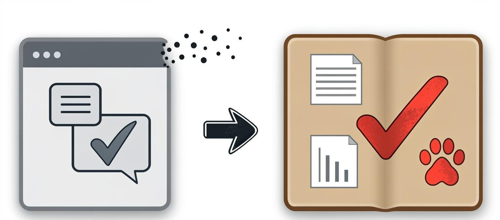

> The new framework now occupies the repository root. Stable self-dependency A is not installed, and no tag has been published. Without a target, init/baseline operate on this framework; under submodules/dossier they default to its host, and an explicit target is also supported. The new layout replaces the old shell; residual private files remain unchanged in local `.zwork/legacy-shell-2026-10-17/` and are not runtime sources. See the [root migration handoff](docs/reports/molt-handoff-2026-10-17.md).

[中文](readme.md) ｜ [English](readme_en.md)

<p align="center">
  
</p>

<h1 align="center">Dossier</h1>

<p align="center">
  <b>One case at a time, and only a stamp makes it count.</b><br>
  Install it with two commands, and your agent moves from “chatting its way to code” to “working by the case file”—you just pick the row, own the result, and make the call.
</p>

<p align="center">
  
</p>
<p align="center"><small>A checkmark in a chat bubble evaporates; one stamped into a case file stands.</small></p>

Close the window, and the process is gone — design decisions, verification history, the paths tried and abandoned, all beyond reach. Dossier keeps the process on disk: every step leaves a record, every conclusion leaves evidence — whether it is done is something you can check yourself. A one-off script needs none of this; long-running projects become traceable — weeks of evolution, dozens of changes, all auditable, all steerable.

> For people who use AI coding agents but have never wrestled with a harness. This page reads in three layers: installation and self-operation are the five-minute layer; the map and desk mailbox are the on-demand layer; the scroll, trust, and governance sections are the deep-read layer.

---

## Installation and self-operation (five-minute layer)

**Dossier is a process harness for AI coding agents.** Add it to your repository as a git submodule, run `init` once, and it lays out a `docs/` skeleton, `CLAUDE.md` / `AGENTS.md`, and a few role files at your repository root. From then on the agent works under its rules: one card at a time; planning and implementation live in two separate sessions; acceptance criteria are declared before the run; and “passed” must point to reproducible evidence.

**Who it’s for**: work where green tests still do not prove correctness—numerical solvers, data pipelines, anything whose deliverable is “a conclusion” rather than “a running thing.”
**Who it’s not for**: projects whose failures are loud. A compiler error, a blank page, or a user noticing immediately makes this density a tax, not insurance.

```text
your-repo/
  CLAUDE.md  AGENTS.md        conventions the agent reads before every run
  .claude/   .cursor/  .codex/   role files, switches, implementation-seat landing points
  docs/
    TODO.md  SESSION.md       to-do list; the current run’s state
    queue.md                  queue: authorize a batch of work units to run in order
    SETUP.md                  desk setup checklist (init lays it out, five steps)
    archives/                 archive pages: old to-do generations; append-only, never cleared
    cmd/  design/  reports/   per-unit cards; contract layer; stage deliverables
  dossier/                    submodule. The master copy itself; you don’t edit it
```

### Install in two steps

```text
# Obtain bootstrap.py from a trusted formal tag or maintainer Release attachment
python bootstrap.py --repository https://github.com/YFG-tec/Dossier --host-root .
```

After installation it checks itself: the five steps in `docs/SETUP.md` boil down to two questions—semantically, are the desk skeleton and role files complete; behaviorally, do the start gate and baseline comparison both come back green. The baseline is written to `.dossier/baseline.json`, and one command, `python submodules/dossier/dossier.py baseline --here`, compares the current fingerprint against it.

### The machine runs itself

It used to be that you had to watch every rule, line by line. Now the work splits into three layers, each with its own job.

First, three entry questions. **It ships no service and connects to no account**: it is just files and check scripts running in your own sessions. **Two seats = two sessions**: the default planning seat is Cursor, the default implementation seat is Claude Code, and Codex CLI can also sit in the implementation seat; you can change the vendors, but you cannot merge the two sessions into one. **What if I have several projects?** Use a git post office: one address per desk, the foreman acts as the postman, and mailbox talk is not evidence. It is an optional adapter; not installing it has zero impact, and installing it does not break the no-service, no-account promise.

**You do four things a day.** Pick a to-do row, say “go,” acknowledge the close, and rule at breakpoints. That is all; the rest is delegated.

**The agent can run a batch on its own.** Put a sequence of to-dos into `docs/queue.md`, and the agent seat walks it down: it picks the row, writes the card, dispatches the build hand, runs the independent review, runs acceptance, closes the case, and commits to your local branch—one report per unit. Its stamp is a **blue stamp** with the same force as yours; it only records who applied it. Seven things are permanently off-limits, and any one of them stops the run and writes the pending decision back into the queue for you (it resumes as soon as you answer): **loosening criteria**, **granting itself authority**, **changing the sequence**, **touching foundation clauses**, **fattening a row**, **an impossible card**, and **review rework**. **The master repository is forever off-limits to agent pushes; the sole exception is the desk post-office repository (dedicated credentials, limited to `.mail`), with no exceptions beyond the three fixed pins.**

**The machinery verifies what was said.** Twenty-two mechanical checks run behind one entry point; every start passes the start gate first—if the execution architecture is half-installed (agents without skills, for example), it turns red immediately instead of letting you discover the missing configuration half a day later. A **host** is the agent program you use (Claude Code, Cursor, Codex, and so on); the master copy translates the role files into each host’s expected shape. Switching hosts does not fail silently: the `templates/` configuration travels with the submodule, host-private files are named in a manifest, and whether a host copy has drifted is a one-command question—`CHANGELOG` tells the host which half needs retranslation.

This self-operation is not magic. The **duty hand** is a scheduled wake-up mechanism: a system scheduled task touches one file every ten minutes, the agent’s “ears” hear it and wake up to work, and a deadman probe continuously checks three faces—whether the scheduled task still exists, whether the heartbeat is beating on schedule, and whether an in-progress lock is stuck. If any face is wrong, it stops and reports instead of pretending everything is fine. If the host has no scheduling capability, development still does not block: it records a dead account and waits for you to ignite it. Installation and removal are both in `docs/design/loop.md`.

## Map and desk mailbox (on-demand layer)

### What to read for what

Open the details as needed; you do not have to read them all first:

| What you want | Read |
|---|---|
| What the directory looks like, where figures live | `rules/directory.md` |
| One work unit, cards, and closing | `rules/workflow.md` |
| Verification, troubleshooting, and what this system cannot verify | `rules/verify.md` |
| Roles, weight levels, and model floors | `rules/roles.md` |
| How Claude Code / Codex CLI land | `rules/claude-code.md` |
| How Cursor lands | `rules/cursor.md` |
| How the queue and automation run | `docs/design/loop.md` |
| Model tiers and dispatch routing | `docs/design/model-routing.md` |
| What exists outside, and why this differs | `rules/sources.md` |
| Unresolved questions | `docs/design/open.md` |
| Runtime | Python ≥ 3.13 (interpreter prefers `.venv`, falls back to system, and creates it on first need), Windows uses Git Bash for checks—environment self-check `bash checks/check-env.sh` |

### Desk mailbox

The desk mailbox is a git post office: one address per desk, the foreman acts as the postman, and mailbox talk is not evidence. It is an optional adapter; not installing it has zero impact, and installing it does not break the no-service, no-account promise.

---

## The scroll (deep-read layer)

A stack of case files, one pulled out at a time to work on. The label on its back tells you which one it is without opening it.
When the work is done, it gets a stamp, and only the stamp makes it count; the stamp is never applied by the same hand that did the work. Pull one out, and the stack remains.

The Chinese project name is “绘卷” (“a painted scroll”), the English name is `Dossier`, and the noun means a case file. Both are about “a roll”: a case file is a bundle with a label on its back (you know which one it is without opening it), and a painted scroll is the unfolded view that shows you the whole stack.

| Term | What it means |
|---|---|
| **Dossier** | This repository. The rules themselves |
| **Desk** | A project repository |
| **Work unit** | One unit of work on a desk |

**There is exactly one master copy, and desks come out of it one by one.**

This system was collected while several numerical projects were being built. Each desk had its own implementation and exploration path. Dossier is not an anthology; it performs **extraction, integration, abstraction, and upgrading**: gaps a single desk did not notice get filled, and management-hostile redundancy gets dropped. Something present in three desks does not automatically enter the common layer. Old desks are under no obligation to be rewritten. The comparison table is in `rules/sources.md`.

---

## Trust (deep-read layer)

The tiering criterion is whether the acceptance criterion is external or internal, not project size. Externally defined work (with a reference implementation or gold standard) should run long with sparse supervision; internally defined work (you build the criterion yourself) should run in short units with dense gates. In the first case this system is a tax; in the second it is the substance.

The second divide is whether failures are loud. A compiler error or a mismatch against reference output is loud; a silent numerical downgrade (declaring three tiers, quietly making the kernel the default, and keeping contract tests green) is quiet. **Dense gates do not buy speed; they buy exposure of silent failure within one work unit.** The defense cannot be “the model is not good enough yet”; it can only be the two conditions “internally defined criteria + silent failure.” When those two no longer hold, the right move is to retreat to long runs, not to add rules.

This management density is unaffordable for human-run projects. It works here because **the marginal cost of enforcing rules has dropped to nearly zero**: writing cards, persisting state, and reconciling line by line are easy for agents, and documents are their only stable memory. The rules are detailed not because the model is clever, but because detail is now affordable.

Criteria are declared first, evidence is reproducible, and the hand that stamps is not the hand that built. The core is not conversion but trust—not turning raw material into product, but making a conclusion **believable**. Even “this can close” is reduced to a machine-readable query: if the predicate is red, no plea counts.

Deviations must state their cost line by line; a hidden deviation is itself a class of failure. The outstanding accounts are laid out in chapters 5 and 6 of `docs/TODO.md`. How this was established is in the next section.

---

## Governance (deep-read layer)

The skeleton has five pieces: **two seats, two gates, cards, layered authority, and state on disk.**

Three things hang on those five: dedicated hands and independent, rerunnable evidence hang under “two seats”; append-only records and never-cleared archive pages hang under “state on disk”; and the one-way source → product relationship hangs under “layered authority”—source may produce product, never the reverse; if you want a change, go to the source side. Disagreement between the two is not the criterion; direction is.

**Two seats** are not two AIs writing code together. The split is a capability difference plus a permission difference. You can change which harness sits in which seat, but **two seats must be two sessions**—that cannot change. A role is not a persona; it is **write permission + what it may do when it fails**.

- The hand that writes a card does not go on to modify the core
- The hand that modifies the core does not change the test criteria
- The hand that writes tests does not “fix” the core until it turns green
- The review hand writes no files; it only checks results against predeclared standards
- Paths named by a card are locked to the card-writing hand (recusal): read-only from the moment the card lands until the case is closed

**Two gates** are case opening and case closing. The human stands only at those two gates.

**A card** is the sole permission surface for that work unit. One card per unit; without a card, the core is off-limits.

**Layered authority**: source is the normative text; product is the compiled harness.

**State on disk**: state is persisted in version control, reproducible, and does not drift in chat.

This guards against seven classes of failure:

1. **Overselling.** You ask for one line of verification, and it opens the next phase.
2. **State in chat.** Switch windows, and scope drifts.
3. **The planning seat and implementation seat grabbing the same core.**
4. **A probe that cannot be reproduced.** A report cites `.tmp/run_*.py`, and the deliverable is dead the next day.
5. **Tests that cannot fail.** Expected and computed values share a source.
6. **Scattering first, then turning numerical knobs.** The symptom disappears, and the contract is swapped.
7. **A picture nobody looks at.** Real errors only show when the image is opened.

**First separate authority by directory, then lock scope with one work unit. Scope, contract, evidence, and permission all land on disk.**

<p align="center">
  
</p>

Obtain bootstrap.py from a trusted formal tag or maintainer Release attachment, then install a selected formal product:

```text
python bootstrap.py --repository https://github.com/YFG-tec/Dossier --host-root .
# Add --version TAG_OR_COMMIT for an explicit version, skipping latest lookup
```

The factory uses `submodules/dossier` and runs the selected product's own code and templates. It creates an empty skeleton; you supply the business content. Ordinary fixed Git submodules may still run `init`; first ensure HEAD matches the host Gitlink.

Restore the pinned version with `git submodule update --init -- submodules/dossier`. Rerunning init only fills missing files. Upgrade with factory plan and reviewed factory apply; baseline refresh only records readings.

To see a full run first: `examples/` contains a working smoke sample of the whole flow (toy core + fake people).

---

## The paw print

Humans have long been unable to keep up with large models at writing code; but the final paw print is the soul.
Hero illustration: generated with GLM-Image, cropped and cleaned by hand.


### Product and development checkout

Select an existing formal product tag explicitly before running the installer. A product tag has this package at its root; the development checkout uses `src/dossier.py`. Bootstrap selects the official GitHub latest formal Release by default; explicit versions skip latest lookup. Only the factory env check ships; development checks and mail fixtures remain on the development desk.

`release build` creates a directly usable standalone Git working directory with new local `.git` metadata, no remote and no development parent history. Its tracked tree is exactly the selected src tree; `.git` is local metadata, never a file in the published commit/tag tree.

## Explicit host runtime upgrades

`runtime plan --ref C --host-root HOST` emits a read-only JSON plan. First adoption requires `--adopt-source REF:src@OLD_PREFIX` for a development source subtree, or `REF:.@OLD_PREFIX` for a product root. For files referencing `src/rules/`, use `HEAD:src@src`. This is a comparison base, not proof of earlier generation.

Review and save the plan, then publish with `release tag VERSION --host-plan PLAN`. Retry an already published annotated tag with `runtime apply --tag VERSION --plan PLAN --host-root HOST`. Inspect with `runtime status --host-root HOST`; restore the last update with `runtime rollback --host-root HOST`. Conflicts stop before activation. Exit 3 means publication succeeded but the requested host update did not; the tag remains fixed. Normal unrelated publication retains its original behavior. Registered development hosts update after publication; no external latest lookup is performed.

The standard `submodules/dossier` submodule and Gitlink pin product P. Host customizations are merged, ledgers and private files retained, and unrelated index entries preserved. Only the latest finite recovery backup is retained; rollback refuses subsequent manual edits. Review host changes and load rules in the next session. No commit or push is performed.

## Factory install and lifecycle

Obtain `bootstrap.py` from a trusted formal product tag or a maintainer-published Release attachment. Then:

```text
python bootstrap.py --repository https://github.com/YFG-tec/Dossier --host-root .
# Optional fixed tag or commit: --version TAG_OR_COMMIT
python submodules/dossier/dossier.py factory plan --repository https://github.com/YFG-tec/Dossier --host-root . > upgrade.json
python submodules/dossier/dossier.py factory apply --plan upgrade.json --host-root .
python submodules/dossier/dossier.py factory status --host-root .
python submodules/dossier/dossier.py factory rollback --host-root .
```

Non-GitHub repositories require an explicit version. Plans fix the canonical repository, selected tag/commit, product tree and host pre-state; apply never queries latest. Existing install runs preserve customizations and the fixed version. Inspect Gitlink/registration and generated changes before committing. Only the env check ships. Rollback retains one completed upgrade and refuses subsequent edits; load changed rules in a new session.

The product includes runtime tools, images, and render stamps; figure generators live in `examples/figures/` in the development repository.
